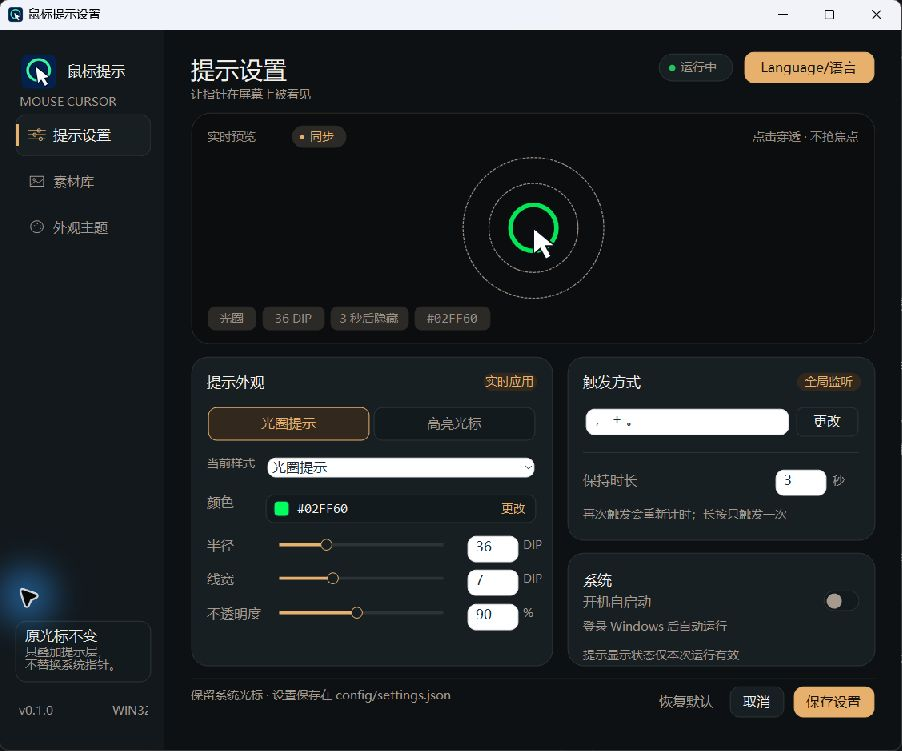
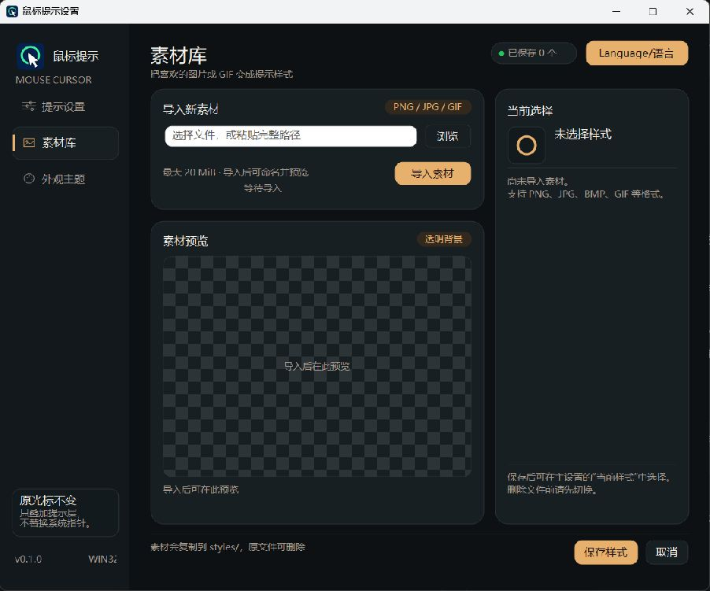
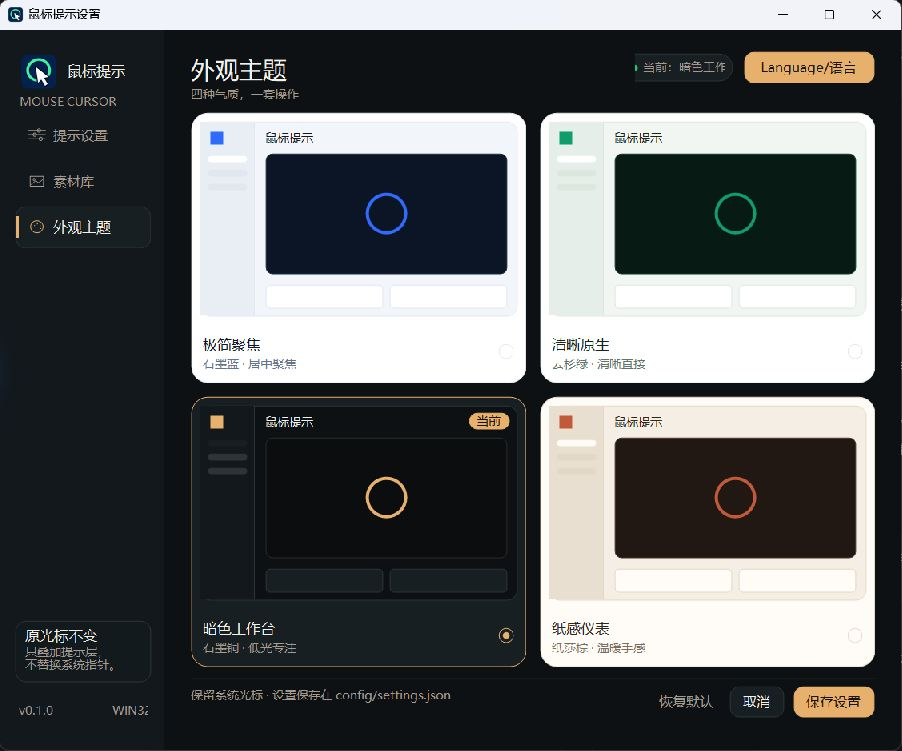

# MouseCursorDetector

适用于 Windows 10/11 x64 的鼠标位置提示工具。按下快捷键，即可在鼠标所在位置显示光圈、高亮或自定义图片/GIF，方便快速找到指针。

## 功能

- **三类提示效果**：空心光圈、半透明圆形高亮、自定义图片或 GIF 动画。
- **外观调整**：设置颜色、大小和不透明度；光圈还可调整线宽，图片保持原始宽高比。
- **自定义快捷键**：支持单键、两个普通键，以及附加 Ctrl、Alt、Shift、Win 的组合。
- **定时隐藏**：保持时长可设为 1–3600 秒，再次触发重新计时。
- **素材库管理**：导入、命名、缩略图浏览和刷新素材；每个素材可独立保存相对指针的位置。
- **窗口内预览**：调整效果后先查看预览，保存后用于实际提示。
- **主题与语言**：提供极简聚焦、清晰原生、暗色工作台、纸感仪表四套主题，支持中文和英文。
- **托盘驻留**：关闭设置窗口后继续监听快捷键，支持当前用户登录时自动启动。
- **保留系统指针**：不替换或隐藏鼠标指针；提示层点击穿透，不影响点击、拖拽和滚动。

以下按当前源码功能说明。截图为已有版本的实际窗口，部分新增功能未在图中展示。

## 操作说明

### 1. 启动软件

- **便携版**：将 `MouseCursorDetector.exe` 放在可写目录，双击启动。
- **安装版**：运行 `MouseCursorDetector-Setup.exe`，选择可写安装目录并完成安装，再通过桌面或开始菜单快捷方式启动。

正常启动会打开设置窗口，并在系统托盘显示图标；软件已运行时，再次启动会恢复并前置现有窗口。每次启动时提示效果默认隐藏。

开启“开机自启动”后，登录 Windows 时只驻留托盘，不自动打开设置或显示提示。该开关切换后立即生效。

### 2. 触发鼠标位置提示

1. 同时按下逗号键和句号键（`,` + `.`），顺序不限。
2. 提示效果出现在鼠标位置，并跟随鼠标移动；默认 3 秒后自动隐藏。
3. 再次触发会重新计时，长按快捷键只触发一次。

快捷键不会拦截按键原有功能，也不会检查其他软件是否使用相同组合。

### 3. 调整外观、快捷键与时长



1. 点击左侧“提示设置”，选择“光圈提示”“高亮光标”，或从“当前样式”选择已登记的图片/GIF。
2. 调整颜色、半径或素材半尺寸、不透明度；光圈可额外调整线宽。数值可直接输入，也可拖动滑块修改。
3. 点击“触发方式”输入框或旁边的“更改”，按下新的快捷键；录制期间暂不触发提示。
4. 将“保持时长”设置为 1–3600 秒。
5. 点击“保存设置”。保存成功后窗口保持打开，新时长从下一次触发生效。

高亮不透明度为 0–100%，默认 25%；光圈和图片/GIF 为 10–100%。0% 高亮完全透明，100% 完全不透明。

默认使用绿色光圈：半径 36 DIP、线宽 7 DIP、不透明度 90%。默认高亮为黄色，半径 24 DIP、不透明度 25%。

已有配置会保留原快捷键。只需更改快捷键时，在输入框重新录制并保存；“恢复默认”还会恢复其他默认设置。

### 4. 导入与选择素材



截图为尚未导入素材的旧版页面，未展示新增的素材列表和刷新按钮。

1. 点击左侧“素材库”。
2. 点击“浏览”选择文件，或在路径框粘贴完整路径，再点击“导入素材”。
3. 验证完成后，在弹窗中输入素材名称；留空使用原文件名。完全相同的名称不可重复，大小写不同允许共存。
4. 在右侧素材列表单击或用方向键选择素材。缩略图显示真实首帧，GIF 在左侧预览区播放动画。
5. 点击“保存配置”，保存当前选择及全部设置并返回提示设置；也可在主页面进一步调整大小和不透明度，再点击“保存设置”。

支持 PNG、JPG/JPEG、BMP、TIFF/TIF、ICO、GIF 等格式，单文件最大 20 MiB。静态图宽高各不超过 4096 像素；GIF 宽高各不超过 1024 像素、最多 200 帧，并受总像素和内存限制。其他格式能否读取取决于系统解码器，不支持 MP4。

图片原有透明区域会保留；没有透明信息的图片不会自动去除底色。TIFF 等非 GIF 多帧图片只取一页。

素材会复制到软件旁的 `styles/`，删除导入前的原文件不影响使用。复制时保留原文件名，重名自动增加 `_1`、`_2` 等后缀，不覆盖已有文件。

### 5. 刷新素材库

进入素材库或点击“刷新”，会重新核对素材目录：

- 将目录内有效但尚未登记的图片/GIF 加入列表，不扫描子目录。
- 清理已确认删除的文件记录；无法访问的文件保留记录并提示不可用。
- 重新读取素材内容；在软件外更新文件后，可点击刷新加载。

选择素材和调整参数只改变窗口预览，保存后才用于快捷键提示。导入和刷新会保留已完成的素材登记，不会提前提交当前选择或位置。

正式使用的素材被确认删除时，立即回退到默认绿色光圈及默认数值，保持 3 秒；快捷键、主题和语言保留。配置写入失败时会报告错误，恢复写入权限后需重新保存。

### 6. 调整图片相对指针的位置

1. 在主设置或素材库中选择图片/GIF。
2. 预览区以当前系统指针图样作为固定参照，拖动图片调整图片中心相对指针热点的位置。
3. 切换素材时，各自保留独立的草稿位置；点击“保存设置”或“保存配置”后正式应用，重新打开和重启后恢复已保存位置。

可以从图片透明区域或预览空白处拖动。图片中心限制在预览舞台内，水平和垂直偏移各不超过 ±512 DIP；超出舞台的部分仅在预览中裁切，实际提示保留完整图片。内置光圈和高亮始终以指针为中心。

素材页取消恢复进入前的位置；主设置取消恢复最近保存的位置。刷新和导入不会提前保存位置。预览中的系统指针只作静态参照，不播放系统指针动画。

### 7. 切换主题与语言



点击左侧“外观主题”，选择主题卡片即可预览。主题只影响软件界面，不改变提示参数或系统鼠标指针。

三个页面右上角的 `Language/语言` 按钮可即时切换中文和英文，不清空当前输入和素材路径。系统对话框、系统错误描述和键名由 Windows 提供；素材名称、路径和许可原文不翻译。

点击“保存设置”或素材页“保存配置”，可在下次启动时恢复所选主题和语言；主设置取消会恢复最近保存值。

### 8. 保存、收起与退出

| 操作 | 结果 |
| --- | --- |
| 主页面“保存设置” | 保存当前样式、位置、外观、快捷键、时长、主题和语言；成功后窗口保持打开 |
| 素材页“保存配置” | 保存整个设置草稿，并返回提示设置 |
| 主页面“取消” | 撤销未保存设置并关闭编辑会话；已登记素材和立即生效的自启动设置保留 |
| 素材页“取消” | 恢复进入素材页前的选择和位置；已完成的素材登记和刷新结果保留 |
| “恢复默认” | 恢复默认设置，保留素材库和文件；点击“保存设置”后提交 |
| 窗口关闭按钮 | 隐藏到托盘，继续监听，保留当前页面与未保存草稿 |
| 最小化 | 保留任务栏按钮和托盘图标，可从任务栏恢复 |
| 双击托盘图标或选择“打开设置菜单” | 恢复或前置设置窗口 |
| 托盘菜单“退出” | 结束程序和快捷键监听 |

保存失败会提示原因并保留编辑，可解决目录权限等问题后重试。导入任务在后台完成时，若设置窗口已隐藏，相关弹窗会等窗口恢复后显示。

### 9. 备份、迁移与卸载

配置和素材始终位于 `MouseCursorDetector.exe` 所在目录，与启动时的工作目录无关：

- `config/`：设置、所选素材及各素材的位置。
- `styles/`：素材文件和素材库映射。

备份或迁移前先退出软件，将 EXE、`config/` 和 `styles/` 一起复制。安装版不会自动迁移便携版数据；可将这两个目录复制到安装目录。开机自启动需在新位置或新电脑重新设置。

覆盖安装到原目录会保留配置和素材；更换安装目录时需自行迁移。安装和卸载前应先从托盘退出软件。

可通过 Windows“已安装的应用”、开始菜单卸载入口或安装目录中的卸载程序移除安装版。**卸载会删除该安装目录的 `config/` 和 `styles/`，包括所有导入素材，请提前备份。** 同时清除快捷方式、指向当前安装的自启动条目及当前用户共享的旧版设置注册表记录；其他目录的便携副本和安装根目录内的无关文件保留。

提示覆盖面向普通用户桌面，独占全屏和系统安全桌面不保证显示。

## 开发说明

### 技术栈与运行形态

项目使用 C++17、Unicode Win32 API、GDI+ 和 Windows WIC，面向 Windows 10/11 x64。界面采用原生窗口与控件，GDI+ 负责提示绘制，WIC 负责图片和 GIF 解码。

主程序以单个 `MouseCursorDetector.exe` 分发，GCC 运行库静态链接，图标、清单与许可内嵌，不需要附带第三方 DLL 或辅助 EXE。安装包使用 Inno Setup，按当前用户安装。

### 源码结构

```text
src/mouse_cursor_detector/
  program.cc        程序入口、单实例与 GDI+ 生命周期
  app.h / app.cc    主线程编排、消息分发、预览与保存
  core/             鼠标钩子、快捷键与登录自启动
  overlay/          透明分层提示窗口与绘制
  settings/         设置模型、持久化、语言、主题与设置界面
  media/            图片/GIF 解码与素材加载
  tray/             托盘图标与菜单
  interop/          自定义窗口消息
  resources/        图标、清单、版本与许可
scripts/build.ps1   构建、依赖检查、打包与产物复制
installer/          当前用户安装包配置
CMakeLists.txt      源文件列表与编译链接配置
CMakePresets.json   Debug / Release 构建预设
```

主线程负责设置窗口、托盘、快捷键及配置文件；钩子线程拥有提示窗口，处理位置跟随、DPI 切换和动画。跨线程设置通过消息及快照传递，素材导入与解码在后台执行。

### 构建方式

使用 MSYS2 UCRT64 GCC、CMake、Ninja；本项目工具链路径为 `C:\GCC\ucrt64\bin`。若调整工具链位置，需同步修改 CMake 预设、VS Code 配置和构建脚本。

在项目根目录任选一种方式构建：

1. 双击 `build.cmd`。
2. 在 VS Code 按 `Ctrl+Shift+B`，运行 `GCC: Build EXE and installer`。
3. 在 PowerShell 中执行：

```powershell
powershell.exe -NoProfile -ExecutionPolicy Bypass -File .\scripts\build.ps1
```

脚本使用 `gcc-release` 配置预设和 `release` 构建预设，检查 x64 PE 及 DLL 导入，随后调用 Inno Setup 生成安装包。首次构建会下载并校验 Inno Setup 6.7.4，准备到项目 `.tools/` 目录；后续复用本地工具。

最终产物复制到项目根目录：

- `MouseCursorDetector.exe`：便携版。
- `MouseCursorDetector-Setup.exe`：安装包。

中间产物分别位于 `build/gcc-release/` 和 `build/installer/`，已有 `config/` 与 `styles/` 保留。构建不会启动或安装产品。VS Code 调试使用 `gcc-debug` 配置预设及 `debug` 构建预设，启动调试前需手动构建。

### 配置与开发约定

- 配置路径以 EXE 所在目录为基准。`config/settings.json` 使用版本 4 的平面 JSON，兼容读取版本 1/2/3；`styles/library.json` 保存唯一的素材名称与文件映射。
- 配置保存所选素材名称及每素材位置，素材路径仅保存在映射表中；文件写入采用同目录临时文件替换，损坏文件不自动覆盖。
- 代码遵循 Google C++ Style Guide，格式以根目录 `.clang-format` 为准；新增 `.cc` 文件需加入 `CMakeLists.txt` 的显式源码列表。
- 提示层保持独立透明窗口，不修改、替换或隐藏系统鼠标指针；鼠标回调不执行文件读写、绘图或同步等待。
- `config/`、`styles/`、`build/`、`dist/`、`.tools/`、`.reference/` 和 `design-previews/` 为本地数据或生成内容，不作为源码提交；根目录两个 EXE 作为交付物纳入版本控制。

模块和线程设计见 [ARCHITECTURE.md](ARCHITECTURE.md)，界面设计见 [DESIGN.md](DESIGN.md)，素材格式和配置字段见 [PORTABLE_STYLES.md](docs/PORTABLE_STYLES.md)，协作约定见 [AGENTS.md](AGENTS.md)。
